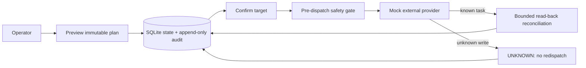

# Safe Media Workflow Reference

一个可独立运行的公开参考实现：把“会产生外部副作用的媒体处理任务”收敛为可预览、可确认、可审计、可恢复的工作流。

> 公开说明：本仓库是基于真实工程问题独立整理的**脱敏参考实现**，不包含任何企业生产源码、客户素材、供应商配置、真实任务记录、日志、凭证或运行数据。所有外部服务均为本地 Mock；仓库中的示例和测试均为虚构数据。

## 解决的工程问题

媒体生成、编辑、发布一类任务常见风险不是“请求发不出去”，而是：重复点击、网络中断后不确定是否已经写入、参数被悄悄改动、恢复时又派发一次，以及多人/多 Worker 竞争执行。本项目将这些风险显式建模：

- 不可变 Preview Snapshot 与计划指纹；
- 明确的 Target 二次确认；
- `PRE_DISPATCH` 审计先于外部写入；
- exactly-once 派发与 `UNKNOWN` 禁止重提；
- 有限只读查询重试与 Read-back 核验；
- SQLite 持久状态、append-only 审计和 Worker Lease；
- Mock Provider 驱动的故障注入测试。

## 架构



详细设计见 [架构说明](docs/ARCHITECTURE.md)、[设计决策](docs/DESIGN_DECISIONS.md)、[故障处理](docs/FAILURE_HANDLING.md) 和 [测试说明](docs/TESTING.md)。

## 核心机制

- **计划不可变**：同一 `request_id` 只能对应同一个内容指纹；参数变化必须创建新请求。
- **防重复外部操作**：提交后状态不再回到可派发；`UNKNOWN` 只允许查询已有任务，不会重新写入。
- **Snapshot 过期**：预览超时后 fail-close，必须重新创建请求，防止陈旧上下文继续执行。
- **Blast Radius**：计划中项目数超过上限，预览阶段直接拒绝。
- **恢复优先**：进程崩溃后从 SQLite 恢复，而非依据页面状态重新提交。
- **并发租约**：多个 Worker 竞争时，只有一个持有可用 Lease。

## 安全设计

- 默认无真实 Provider 集成、无网络凭证、无生产端点。
- `.gitignore` 排除环境变量、数据库、日志、运行目录、下载与备份。
- `.env.example` 不含真实值；接入任何真实系统前应在独立私有部署中完成安全评审。
- 审计采用追加写入，示例不保存个人信息或业务数据。

## 本地运行

要求：Python 3.11+。

```powershell
python -m venv .venv
.\.venv\Scripts\Activate.ps1
pip install -r requirements.txt
pytest -q
python run.py
```

健康检查：`http://127.0.0.1:8080/health`

预览示例：

```powershell
Invoke-RestMethod -Method Post http://127.0.0.1:8080/preview `
  -ContentType 'application/json' `
  -InFile examples/sample_request.json
```

## 公开版测试结果

本公开版的测试独立运行，测试数不引用任何生产项目历史数据。覆盖正常路径、重复派发、主键校验、Target/Schema Gate、Snapshot 过期、冲突、Blast Radius、有限读取重试、不可重试错误、UNKNOWN、Read-back 不一致、崩溃恢复、Lease 竞争和 API Health。运行方法见 [测试说明](docs/TESTING.md)。

## 已知限制

- Provider 是 deterministic Mock，不代表任何云服务、模型或生产 SLA。
- SQLite 适用于单机演示；多节点生产需要替换为具备事务和锁语义的共享存储。
- 本项目展示安全执行编排，不提供媒体生成算法或业务素材处理能力。

## 面试官阅读路线

1. 从 `mediaflow/domain.py` 看不可变计划与输入 Gate；
2. 从 `mediaflow/engine.py` 看 exactly-once、UNKNOWN 与 reconciliation；
3. 从 `mediaflow/store.py` 看持久化审计与租约；
4. 从 `tests/test_workflow.py` 看故障注入与可验证边界；
5. 阅读 [设计决策](docs/DESIGN_DECISIONS.md) 了解权衡。

## 技术栈

Python 3.11+ · Flask · SQLite · pytest · 标准库 `dataclasses` / `hashlib`

## License

MIT，见 [LICENSE](LICENSE)。
